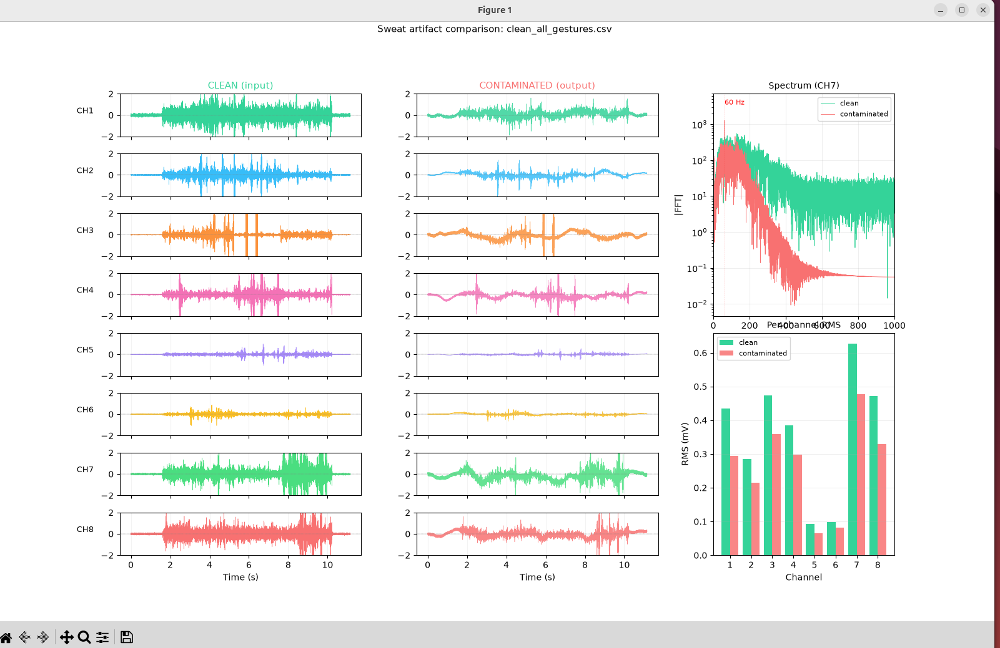
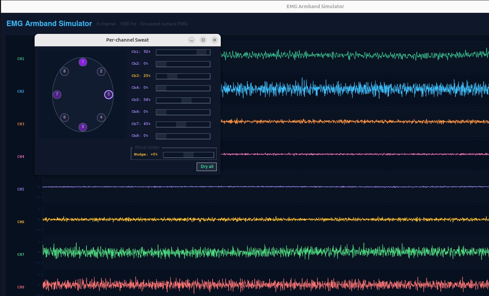
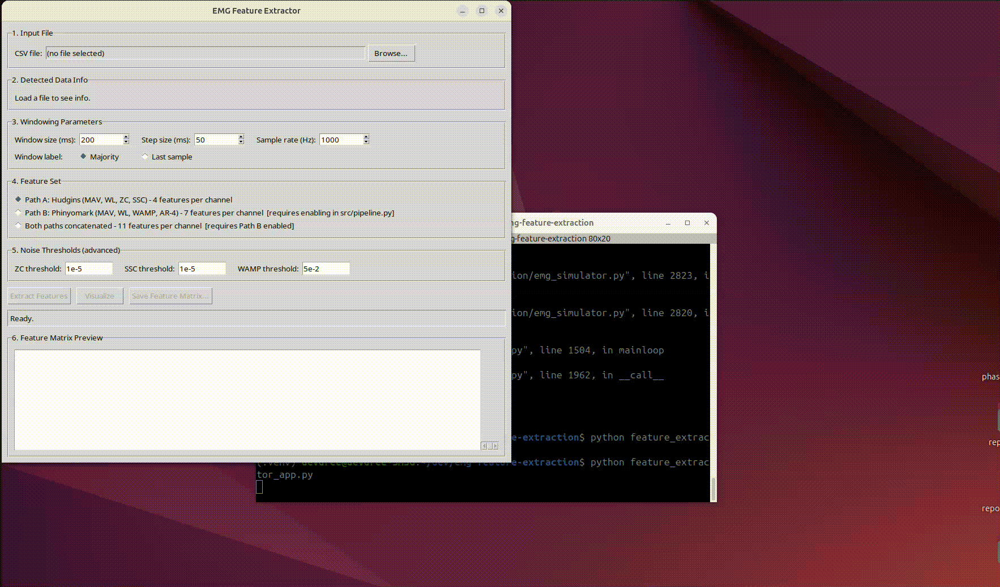
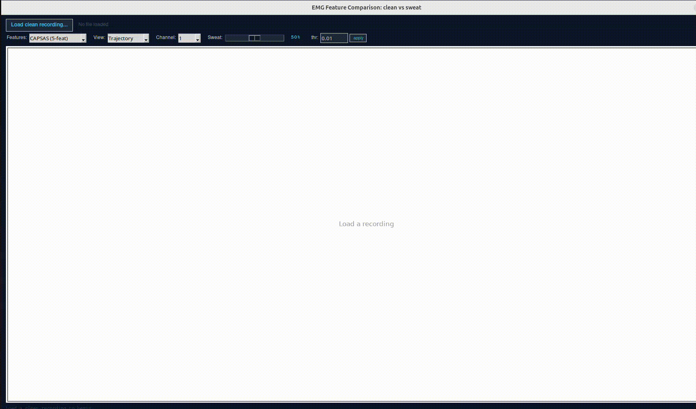

# EMG Simulator and Feature Extraction Pipeline

An 8-channel surface EMG simulator with a physically-grounded sweat
artifact model, plus a feature extraction pipeline for myoelectric
gesture classification. Built for research into decoder robustness
under signal degradation.

<!-- IMAGE 1: hero GIF -->


## What this does

Surface EMG decoders degrade in real use: sweat, electrode shift, and
fatigue shift the feature distribution away from what the classifier
was trained on. This repo provides a controllable source of that
degradation. You generate synthetic EMG with known artifact levels,
extract features, and measure how class separability responds.

Three entry points:

| Script                     | Purpose                                                      |
|----------------------------|--------------------------------------------------------------|
| `emg_simulator.py`         | Real-time GUI: gesture selection, live artifact control, CSV recording |
| `feature_extractor_app.py` | Load a recording, extract features, export a feature matrix  |
| `compare_features_app.py`  | Clean vs. artifact comparison: feature trajectories and PCA cluster view |

## Install

Python 3.12. See `.python-version`.

```bash
./setup.sh                  # creates .venv, installs requirements.txt
source .venv/bin/activate
export PYTHONPATH=.
python emg_simulator.py
```

Windows (cmd.exe):

```
setup.bat
.venv\Scripts\activate.bat
set PYTHONPATH=.
python emg_simulator.py
```

`PYTHONPATH=.` is required because the apps import from `src/` while
running from the repo root.

## Layout

```
emg_simulator.py            Real-time GUI simulator (Tkinter + matplotlib)
feature_extractor_app.py    Feature extraction GUI
compare_features_app.py     Clean vs. artifact comparison GUI
apply_sweat_offline.py      Apply the sweat model to an existing CSV
load_emg_recording.py       Load recordings/calibration CSVs into the simulator
ninapro_to_calibration.py   Convert NinaPro DB2 .mat files to calibration CSVs

src/artifacts/base.py       BaseArtifact: the interface all artifacts implement
src/artifacts/sweat.py      SweatProcessor: four-mechanism sweat model

src/features/windowing.py   Sliding-window segmentation
src/features/features.py    Time-domain feature functions
src/features/pipeline.py    Signal to feature-matrix orchestration
src/features/data_loading.py
src/features/visualizer.py  Animated feature plots

tests/                      pytest suite
scripts/                    One-off validation diagnostics
notes/                      Model provenance documentation
```

## Sweat model

`SweatProcessor` implements four mechanisms, each independently
toggleable:

1. **Amplitude attenuation** — saturating sigmoid (Abdoli-Eramaki et al., 2012)
2. **Low-pass filtering** — conductive shunting of high frequencies (De Luca, 1997)
3. **Baseline drift** — 0.5 Hz wander, fs-invariant via noise-gain normalization (De Luca et al., 2010)
4. **Powerline pickup** — CMRR degradation at 60 Hz plus harmonics (Webster, 1984; Xu et al., 2020)

Sweat level is per-channel and continuous in [0, 1].

<!-- IMAGE 2: clean vs. sweaty signal -->


<!-- IMAGE 3: per-channel sweat control -->


See `notes/sweat_model_provenance.md` for which decisions are
literature-grounded and which are modeling choices.

## Features

Three feature sets:

- **Hudgins** (Hudgins et al., 1993): MAV, ZC, SSC, WL
- **Phinyomark** (Phinyomark et al., 2012): extended time-domain set
- **CAPSAS**: MAV, population variance, WL, ZC, SSC — 5 features x 8 channels = 40 per window

ZC and SSC thresholds are configurable, since both are noise-sensitive.

<!-- IMAGE 4: feature extractor GUI -->


### Separability under artifact load

`compare_features_app.py` projects the feature matrix to 2D with PCA and
scores class separability with 5-fold k-NN. Sweat level is a live
control, so you can watch gesture clusters merge as the artifact
intensifies.

<!-- IMAGE 5: the money shot -->


## Tests

```bash
./run_tests.sh
```

The wrapper sets `PYTEST_DISABLE_PLUGIN_AUTOLOAD=1` to avoid a conflict
with ROS 2's pytest plugins on systems where ROS is installed.

Coverage: sigmoid attenuation shape, sample-rate invariance, powerline
harmonics, per-channel isolation, and generator spectrum stability.

Sample-rate invariance is the non-obvious one. An earlier version had a
shaping filter whose passband scaled with Nyquist, so at high fs the
generator leaked energy above 400 Hz that the sweat low-pass then
removed, making 1% sweat halve the signal. Tests assert the spectral
centroid stays in 175-215 Hz and above-400 Hz energy stays under 6% at
every sample rate.


## Validation status

The sweat model is grounded in published measurements of how sweat
affects skin-electrode impedance and EMG signal properties. It has
**not** been validated against recordings with sweat as a labeled
variable, because no public dataset provides that. Tolerances in the
test suite come from measured post-fix behavior of this implementation,
not from ground-truth comparison.

The four mechanisms run independently rather than coupled. Real sweat
affects them jointly.

## Build a standalone executable

```bash
./build_exe.sh      # or build_exe.bat on Windows
```